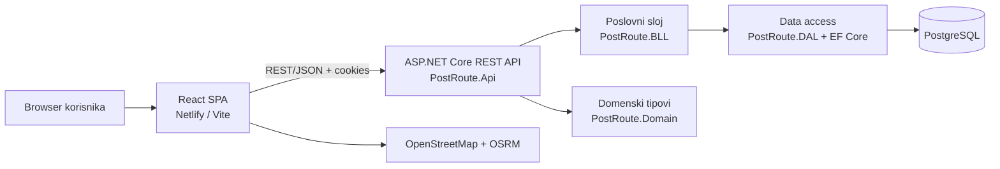

# PostRoute

> Web aplikacija za planiranje, optimizaciju, dodjelu i praćenje ruta za punjenje i pražnjenje poštanskih sandučića.

PostRoute pomaže poštanskim dispečerima da brže planiraju dnevni rad, poštarima da izvršavaju dodijeljene rute na terenu, a administratorima i nadzoru da upravljaju podacima, prate realizaciju i analiziraju rezultate.

Projekat je razvijen kao studentski MVP/finalna iteracija. Osnovni korisnički tokovi su implementirani, ali sistem nije namijenjen neposrednoj produkcijskoj upotrebi bez dodatnog sigurnosnog podešavanja, hardeninga i proširenja testiranja.

## Sadržaj

- [Ključne funkcionalnosti](#ključne-funkcionalnosti)
- [Korisničke uloge](#korisničke-uloge)
- [Arhitektura](#arhitektura)
- [Tehnološki stack](#tehnološki-stack)
- [Struktura repozitorija](#struktura-repozitorija)
- [Preduvjeti](#preduvjeti)
- [Lokalno pokretanje](#lokalno-pokretanje)
- [Testiranje i provjera kvaliteta](#testiranje-i-provjera-kvaliteta)
- [Deployment](#deployment)
- [Demo korisnici](#demo-korisnici)
- [Poznata ograničenja](#poznata-ograničenja)
- [Dokumentacija](#dokumentacija)
- [Doprinos projektu](#doprinos-projektu)
- [Licenca](#licenca)

## Ključne funkcionalnosti

- prijava, odjava i promjena početne lozinke
- autentifikacija zasnovana na cookie/session mehanizmu
- kontrola pristupa prema korisničkim ulogama
- upravljanje korisnicima i poštarima
- kreiranje, izmjena, pretraga i filtriranje poštanskih sandučića
- unos koordinata sandučića putem interaktivne mape
- prioriteti, radni dani, statusi i vremenski prozori dostupnosti sandučića
- automatsko generisanje ruta za odabrani datum
- ručno preuređivanje redoslijeda stavki rute
- dodjela rute dostupnom poštaru
- izvršavanje dodijeljene rute na terenu
- evidentiranje obrađenih, ispražnjenih i nedostupnih lokacija
- prijava i praćenje problema na terenu
- komentari, statusna historija i notifikacije za probleme
- dispečerski dashboard sa periodičnim osvježavanjem podataka
- arhiva završenih ruta
- izvještaj o učinku poštara
- izvještaj o realizaciji prema tipu sandučića
- audit historija izmjena sandučića
- sigurnosni logovi prijava i odbijenih pristupa
- prikaz mapa preko Leaflet/OpenStreetMap i vizuelno rutiranje preko OSRM-a

## Korisničke uloge

| Uloga | Odgovornosti |
| --- | --- |
| **Administrator** | upravljanje korisnicima i sandučićima, pregled historije i administrativnih ekrana |
| **Dispatcher / Dispečer** | generisanje, dodjela, praćenje i ručna izmjena ruta; pregled problema i izvještaja |
| **Postal Worker / Poštar** | pregled dodijeljene rute, rad na terenu, ažuriranje statusa i prijava nedostupnih lokacija |

## Arhitektura

PostRoute je modularni monolit sa odvojeno deployanim frontend, backend i baznim servisom:



### Backend slojevi

- **API** — HTTP kontroleri, API ugovori, validacija, CORS, autentifikacija, autorizacija i middleware.
- **BLL** — poslovna pravila, orkestracija use-caseova, generisanje i praćenje ruta, problemi i izvještaji.
- **DAL** — `AppDbContext`, EF Core entiteti, repozitoriji, konfiguracija relacija i migracije.
- **Domain** — zajedničke domenske vrijednosti, uključujući korisničke uloge i enum tipove.

Kontroleri ne pristupaju bazi direktno. Tipičan zahtjev prolazi kroz frontend API modul, Axios klijent, ASP.NET Core kontroler, BLL servis, DAL repozitorij i PostgreSQL.

### Frontend slojevi

- `ui` — stranice, layouti i prezentacijske komponente
- `application` — hookovi i koordinacija aplikacijskog toka
- `infrastructure` — API klijent, konfiguracija, routing, role guardovi i tehnička integracija
- `shared` — zajednički tipovi i pomoćne funkcije
- `styles` — globalni i layout stilovi

Frontend koristi centralizovani Axios klijent sa `withCredentials: true`, jer se autentifikacija trenutno zasniva na session cookiejima.

### Generisanje ruta

`RouteService.GenerateRouteAsync` implementira MVP nearest-neighbor heuristiku:

1. učitavaju se aktivni sandučići;
2. sandučići se filtriraju prema radnom danu i prethodnom uključivanju u rutu;
3. prioriteti se obrađuju redom: visok, srednji, nizak;
4. unutar prioriteta bira se najbliži dostupan sandučić;
5. provjeravaju se vremenski prozori i procijenjeno vrijeme dolaska;
6. ruta je ograničena na najviše 50 tačaka;
7. čuvaju se `Route` i `RouteItem` zapisi.

Algoritam je prilagođen MVP-u i ne koristi stvarno stanje saobraćaja, gužve ili radove na putu.

## Tehnološki stack

### Backend

- C# i .NET 9
- ASP.NET Core 9 Web API
- Entity Framework Core 9
- Npgsql
- PostgreSQL 16
- OpenAPI u development okruženju
- Docker runtime za deployment

### Frontend

- React 19
- TypeScript
- Vite 8
- React Router 7
- Axios
- React Hook Form i Zod
- Leaflet, React Leaflet i Leaflet Routing Machine
- Sonner za toast notifikacije
- Vitest i Testing Library

### Deployment i automatizacija

- Docker i Docker Compose
- GitHub Actions
- Netlify za frontend
- Render za backend
- managed PostgreSQL servis za produkcijsku bazu

## Struktura repozitorija

```text
.
├── PROJEKAT/
│   ├── backend/
│   │   ├── PostRoute.sln
│   │   ├── src/
│   │   │   ├── PostRoute.Api/       # REST API, kontroleri, middleware i konfiguracija
│   │   │   ├── PostRoute.BLL/       # poslovni servisi, modeli i pravila
│   │   │   ├── PostRoute.DAL/       # EF Core, repozitoriji i migracije
│   │   │   └── PostRoute.Domain/    # zajednički domenski tipovi
│   │   └── tests/
│   │       ├── PostRoute.Api.Tests/
│   │       ├── PostRoute.BLL.Tests/
│   │       └── PostRoute.DAL.Tests/
│   ├── frontend/
│   │   ├── src/
│   │   │   ├── app/                 # root composition
│   │   │   ├── ui/                  # stranice, layouti i komponente
│   │   │   ├── application/         # hookovi i orkestracija
│   │   │   ├── infrastructure/      # API, routing i konfiguracija
│   │   │   ├── shared/              # tipovi i utility funkcije
│   │   │   └── styles/              # globalni stilovi
│   │   ├── package.json
│   │   └── package-lock.json
│   ├── docker-compose.dev.yml       # lokalni PostgreSQL 16
│   ├── create-admin.ps1             # pomoćna skripta za kreiranje admina
│   └── README.md                     # detalji lokalnog setupa
├── Sprint1 ... Sprint11/             # projektna, sprint i finalna dokumentacija
├── .github/
│   ├── workflows/                    # backend i frontend CI/CD
│   └── instructions/                 # repo-specifične Copilot instrukcije
├── netlify.toml                      # Netlify frontend build konfiguracija
└── render.yaml                       # Render backend deployment konfiguracija
```

## Preduvjeti

Za lokalni razvoj potrebno je instalirati:

- Git
- .NET SDK 9
- Node.js 24 i npm
- Docker Desktop ili Docker Engine sa Docker Compose podrškom
- `dotnet-ef` alat za EF Core migracije

Ako `dotnet-ef` nije instaliran:

```bash
dotnet tool install --global dotnet-ef
```

## Lokalno pokretanje

### 1. Kloniranje repozitorija

```bash
git clone https://github.com/KerimSikalo/PostRoute.git
cd PostRoute
```

### 2. Pokretanje PostgreSQL baze

Iz foldera `PROJEKAT` pokrenite:

```bash
cd PROJEKAT
docker compose -f docker-compose.dev.yml up -d
```

Lokalna PostgreSQL baza koristi:

- host: `localhost`
- port: `5433`
- baza: `postroute`
- korisnik: `postgres`
- lozinka: `postgres`

Docker podaci se čuvaju u volumenu `postroute-dev-data`.

### 3. Backend konfiguracija

Kreirajte `PROJEKAT/backend/src/PostRoute.Api/appsettings.Development.json` ako ne postoji:

```json
{
  "ConnectionStrings": {
    "DefaultConnection": "Host=localhost;Port=5433;Database=postroute;Username=postgres;Password=postgres"
  },
  "Logging": {
    "LogLevel": {
      "Default": "Information",
      "Microsoft.AspNetCore": "Warning"
    }
  }
}
```

Konfiguracione datoteke sa lokalnim vrijednostima ne treba commitovati.

### 4. Primjena migracija

```bash
cd PROJEKAT/backend
dotnet ef database update \\
  --project src/PostRoute.DAL \\
  --startup-project src/PostRoute.Api
```

Backend pri pokretanju takođe primjenjuje pending migracije kroz `Database.MigrateAsync()`.

### 5. Pokretanje backenda

```bash
cd PROJEKAT/backend
dotnet run --project src/PostRoute.Api
```

Korisni endpointi:

- API health check: `http://localhost:5000/health`
- Swagger/OpenAPI u development okruženju: `http://localhost:5000/swagger`

Stvarni port može zavisiti od lokalnog launch profila i konfiguracije. Ako aplikacija ispiše drugi port u terminalu, koristite taj port.

### 6. Pokretanje frontenda

U drugom terminalu:

```bash
cd PROJEKAT/frontend
npm ci
npm run dev
```

Frontend je dostupan na:

```text
http://localhost:5173
```

Za komunikaciju sa backendom frontend koristi `VITE_API_BASE_URL`. U lokalnom okruženju može se postaviti u `.env` datoteci frontend projekta, na primjer:

```env
VITE_API_BASE_URL=http://localhost:5000
```

Ako backend radi na drugom portu, vrijednost mora odgovarati stvarnoj adresi.

## Testiranje i provjera kvaliteta

### Backend

Iz root foldera repozitorija:

```bash
dotnet restore PROJEKAT/backend/PostRoute.sln
dotnet build PROJEKAT/backend/PostRoute.sln --configuration Release
dotnet test PROJEKAT/backend/PostRoute.sln --configuration Release
```

### Frontend

```bash
cd PROJEKAT/frontend
npm ci
npm run lint
npm run build
npm test
```

Za coverage izvještaj:

```bash
npm run test:coverage
```

GitHub Actions automatski provjerava backend restore/build/test i frontend install/lint/build na relevantnim push i pull request događajima za `main` i `develop`.

## Deployment

Produkciona topologija je podijeljena na više servisa:

- **Frontend:** React SPA se builda i servira preko Netlifyja.
- **Backend:** ASP.NET Core API se builda kao Docker servis na Renderu.
- **Baza:** PostgreSQL managed servis.
- **CI/CD:** GitHub Actions provjerava build i testove; frontend se na push u `main` deploya na Netlify, dok Render koristi auto-deploy konfiguraciju.

Relevantne konfiguracije:

- [`netlify.toml`](netlify.toml)
- [`render.yaml`](render.yaml)
- [`backend-ci.yml`](.github/workflows/backend-ci.yml)
- [`frontend-ci.yml`](.github/workflows/frontend-ci.yml)

Relevantne environment varijable i secrets:

- `VITE_API_BASE_URL` — javna adresa backend API-ja koju frontend koristi tokom builda
- `ConnectionStrings__DefaultConnection` — produkcijski PostgreSQL connection string
- `Cors__AllowedOrigins__0` — dozvoljeni frontend origin
- `Seeding__Enabled` — uključivanje ili isključivanje seed podataka
- `NETLIFY_AUTH_TOKEN` i `NETLIFY_SITE_ID` — GitHub Actions secrets za Netlify deploy

Tajne se ne upisuju u repozitorij. Frontend produkcijska adresa dokumentovana u projektu je [postrouteapp.netlify.app](https://postrouteapp.netlify.app). Javni backend URL nije hardkodiran u ovom README-u; određuje se kroz deployment konfiguraciju.

## Demo korisnici

Za razvoj i demonstraciju postoje seed korisnici. Koristite ih isključivo lokalno ili u demo okruženju:

| Uloga | Email | Lozinka |
| --- | --- | --- |
| Administrator | `admin@mail.com` | `Admin123!` |
| Poštar | `postar@mail.com` | `Postar123!` |
| Poštar | `postar1@mail.com` | `Postar123!` |

Dokumentacija navodi i dispečersku ulogu, ali konkretne seed naloge treba provjeriti u aktuelnoj seed konfiguraciji prije prezentacije. Demo lozinke se moraju promijeniti ili ukloniti prije bilo kakvog stvarnog produkcijskog korištenja.

## Poznata ograničenja

- Sistem nema offline režim; frontend, backend, baza i vanjski map servisi moraju biti dostupni.
- Dashboard koristi periodično HTTP osvježavanje, a ne WebSocket ili drugi pravi real-time push mehanizam.
- Mape i vizuelno rutiranje zavise od OpenStreetMap i javnog OSRM servisa.
- Generisanje rute je MVP heuristika; ne uzima u obzir stvarni saobraćaj, gužve ili radove na putu.
- Dio ekrana, kao što su statistika, postavke i pojedini radnički pregledi, predstavlja osnovu za buduće proširenje.
- End-to-end testiranje kroz browser, posebno za mape i vanjske routing servise, nije potpuno automatizovano.
- Cookie autentifikacija u produkciji koristi cross-site cookie podešavanja, ali anti-CSRF zaštitu treba dodatno uvesti prije produkcijske upotrebe.
- Session state se čuva u memoriji jedne backend instance; restart ili horizontalno skaliranje zahtijevaju dodatno rješenje za distribuiranu sesiju.
- Dio read-only endpointa zahtijeva dodatnu provjeru backend autorizacije.
- Demo korisnici i početne lozinke namijenjeni su evaluaciji, ne produkciji.

## Dokumentacija

Korisni dokumenti u repozitoriju:

- [Lokalni setup](PROJEKAT/README.md)
- [Backend bilješke](PROJEKAT/backend/README.md)
- [Frontend bilješke](PROJEKAT/frontend/README.md)
- [Tehnički i arhitektonski pregled](Sprint11/ArchitectureTechnicalOverview.md)
- [Release notes](Sprint11/ReleaseNotes.md)
- [Poznata ograničenja](Sprint11/KnownIssues.md)
- [Deployment procedura](Sprint11/DeploymentProcedura.md)
- [Continuous deployment](Sprint11/ContinuousDeployment.md)
- [Korisničko uputstvo](Sprint11/UserManual.md)
- [Sažetak testiranja](Sprint11/TestSummary.md)
- [Finalni product backlog](Sprint11/FinalProductBacklog.md)

## Doprinos projektu

Prije izmjena:

1. pregledajte postojeću strukturu odgovarajućeg sloja;
2. pratite postojeća pravila imenovanja i arhitekture;
3. poslovnu logiku držite u BLL-u, a persistence u DAL-u;
4. frontend HTTP pozive držite u infrastructure/API sloju;
5. dodajte ili ažurirajte testove kada je ponašanje izmijenjeno;
6. provjerite da li izmjena utiče na relevantnu sprint dokumentaciju.

Preporučeni tok rada je kratkotrajna feature/fix/docs grana, commit sa jasnim prefiksom kao što su `feat:`, `fix:`, `docs:`, `test:` ili `refactor:`, a zatim pull request sa uspješnim CI provjerama.

## Licenca

U repozitoriju trenutno nije definisana licenca. Prije javnog korištenja, redistribucije ili uključivanja projekta u drugi proizvod potrebno je dodati odgovarajuću licencu i usaglasiti prava autora.
