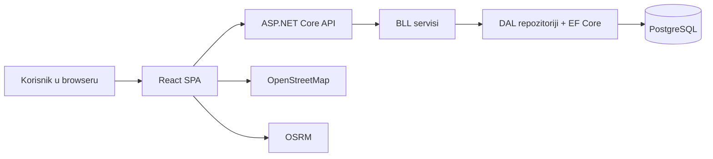

# PostRoute

Modularni monolit za planiranje, optimizaciju, dodjelu, praćenje i izvještavanje ruta punjenja/pražnjenja poštanskih sandučića.

[](https://github.com/KerimSikalo/PostRoute/actions/workflows/backend-ci.yml)
[](https://github.com/KerimSikalo/PostRoute/actions/workflows/frontend-ci.yml)

## Pregled

**PostRoute** rješava ručno i sporo planiranje dnevnih obilazaka sandučića tako što dispečeru daje automatski generisanu rutu (MVP heuristika), mogućnost ručnog preuređivanja i dodjele poštaru, te kontinuiran pregled realizacije i problema na terenu.

Repozitorij sadrži **funkcionalnu studentsku MVP/finalnu implementaciju** (nije skeleton), sa poznatim ograničenjima navedenim niže.

## Glavne korisničke uloge

- **Administrator**
- **Dispatcher (Dispečer)**
- **Postal Worker (Poštar)**

## Implementirane funkcionalnosti

- prijava/odjava i obavezna promjena inicijalne lozinke
- autentifikacija zasnovana na **cookie/session** pristupu (nije JWT)
- RBAC pristup po ulogama (backend + frontend guardovi)
- upravljanje sandučićima (unos, izmjena, tip, prioritet, radni dani, vremenski prozori)
- generisanje ruta za odabrani datum i poštara
- ručno preuređivanje redoslijeda i dodjela rute
- terenska realizacija stavki rute i evidencija nedostupnosti
- prijava i praćenje problema (issue tok)
- dispečerski dashboard sa periodičnim polling-om
- arhiva ruta i osnovni eksport tokovi
- izvještaji (performanse poštara, statistika po tipu sandučića)
- audit/sigurnosni logovi
- mapa i rutiranje preko Leaflet/OpenStreetMap + OSRM integracije

## Arhitektura

- **Frontend:** React SPA (`PROJEKAT/frontend`)
- **Backend:** ASP.NET Core 9 REST API (`PROJEKAT/backend/src/PostRoute.Api`)
- **Slojevi:** API -> BLL -> DAL (+ Domain)
- **Baza:** PostgreSQL 16
- **Vanjski servisi:** OpenStreetMap tile servis, OSRM routing servis

Kontroleri delegiraju posao BLL servisima; BLL koristi DAL repozitorije; DAL radi EF Core/Npgsql pristup bazi. Frontend komunicira isključivo preko REST API-ja.



## Struktura repozitorija

```text
.
├── PROJEKAT/
│   ├── README.md
│   ├── docker-compose.dev.yml            # PostgreSQL 16 (lokalno 5433:5432)
│   ├── create-admin.ps1
│   ├── backend/
│   │   ├── PostRoute.sln
│   │   ├── Dockerfile
│   │   ├── src/
│   │   │   ├── PostRoute.Api
│   │   │   ├── PostRoute.BLL
│   │   │   ├── PostRoute.DAL
│   │   │   └── PostRoute.Domain
│   │   └── tests/
│   │       ├── PostRoute.Api.Tests
│   │       ├── PostRoute.BLL.Tests
│   │       └── PostRoute.DAL.Tests
│   └── frontend/
│       ├── package.json
│       └── src/
│           ├── app
│           ├── ui
│           ├── application
│           ├── infrastructure
│           ├── shared
│           └── styles
├── Sprint11/
│   ├── ArchitectureTechnicalOverview.md
│   ├── ReleaseNotes.md
│   ├── KnownIssues.md
│   └── ContinuousDeployment.md
├── .github/workflows/
│   ├── backend-ci.yml
│   └── frontend-ci.yml
├── render.yaml
└── netlify.toml
```

## Tehnološki stack (aktuelno stanje u repozitoriju)

- Backend: ASP.NET Core 9, C#/.NET (`net9.0` u API/BLL/DAL), EF Core 9, Npgsql, PostgreSQL 16
- Frontend: React 19, TypeScript, Vite 8, React Router 7, Axios, React Hook Form, Zod, Leaflet/React Leaflet, Vitest
- CI/CD: GitHub Actions, Netlify (frontend), Render Docker servis (backend)

## Preduslovi

- .NET SDK 9
- Node.js 24 + npm
- Docker (za lokalni PostgreSQL)

## Lokalni razvoj (iz korijena repozitorija)

### 1) Pokretanje PostgreSQL baze

```bash
cd PROJEKAT
docker compose -f docker-compose.dev.yml up -d
```

Baza se podiže na host portu **5433**.

### 2) `appsettings.Development.json` (backend)

Kreirati fajl: `PROJEKAT/backend/src/PostRoute.Api/appsettings.Development.json`

```json
{
  "ConnectionStrings": {
    "DefaultConnection": "Host=localhost;Port=5433;Database=postroute;Username=postgres;******"
  },
  "Logging": {
    "LogLevel": {
      "Default": "Information",
      "Microsoft.AspNetCore": "Warning"
    }
  }
}
```

### 3) EF migracije

```bash
cd PROJEKAT/backend
dotnet ef database update --project src/PostRoute.DAL --startup-project src/PostRoute.Api
```

### 4) Pokretanje backenda

```bash
cd PROJEKAT/backend
dotnet run --project src/PostRoute.Api
```

- Swagger: `http://localhost:5000/swagger`
- Health: `http://localhost:5000/health`
- Napomena: efektivni port može zavisiti od launch/profila okruženja.

### 5) Pokretanje frontenda

```bash
cd PROJEKAT/frontend
npm ci
npm run dev
```

Frontend lokalno: `http://localhost:5173`

> `VITE_API_BASE_URL` treba postaviti na backend URL (npr. `http://localhost:5000`) da bi API pozivi radili ispravno.

## Build / test / lint

### Backend

```bash
cd PROJEKAT/backend
dotnet restore PostRoute.sln
dotnet build PostRoute.sln --configuration Release
dotnet test PostRoute.sln --configuration Release
```

### Frontend

```bash
cd PROJEKAT/frontend
npm ci
npm run lint
npm run build
npm run test
```

## Deployment pregled

- **Frontend:** Netlify (`netlify.toml`), produkcijski URL dokumentovan kao: https://postrouteapp.netlify.app
- **Backend:** Render Docker servis (`render.yaml`, rootDir `PROJEKAT/backend`, health `/health`)
- **Baza:** managed PostgreSQL servis
- **CI/CD:** GitHub Actions workflowi za frontend i backend

Relevantne varijable (bez tajni u repozitoriju):

- `VITE_API_BASE_URL`
- `ConnectionStrings__DefaultConnection`
- `Cors__AllowedOrigins__0`
- `Seeding__Enabled`

## Demo korisnici (samo za demonstraciju)

Dokumentovani demo nalozi postoje u sprint dokumentaciji i seed logici; koristiti isključivo za test/demo, ne za produkciju:

- `admin@mail.com` / `Admin123!`
- `dispatcher@mail.com` / `Dispatcher123!`
- `postar@mail.com` / `Postar123!`
- `postar1@mail.com` / `Postar123!`

## MVP ograničenja / caveats

- nema offline moda
- dashboard koristi polling (nije real-time push/WebSocket)
- prikaz mape i putanja zavisi od dostupnosti OpenStreetMap/OSRM servisa
- optimizacija rute je heuristička (nearest-neighbor stil), nije traffic-aware niti globalno optimalna
- dio ekrana/tokova je djelimično završen ili placeholder
- automatski testovi ne pokrivaju kompletan end-to-end browser tok
- potrebna su dodatna produkcijska sigurnosna hardening podešavanja (npr. strože endpoint zaštite i anti-CSRF strategija)

### Pravila generisanja rute (trenutna MVP implementacija)

Generisanje poštuje prioritete i ograničenja: prioritetni redoslijed, radni dani, cooldown pravila po prioritetu, vremenske prozore dostupnosti, procjenu vremena dolaska i limit od **50** tačaka po ruti.

## Korisna dokumentacija

- Arhitektura: [`Sprint11/ArchitectureTechnicalOverview.md`](Sprint11/ArchitectureTechnicalOverview.md)
- Release napomene: [`Sprint11/ReleaseNotes.md`](Sprint11/ReleaseNotes.md)
- Poznata ograničenja: [`Sprint11/KnownIssues.md`](Sprint11/KnownIssues.md)
- Deployment/CD: [`Sprint11/ContinuousDeployment.md`](Sprint11/ContinuousDeployment.md)
- Lokalni setup (komponentni): [`PROJEKAT/README.md`](PROJEKAT/README.md)
- Backend detalji: [`PROJEKAT/backend/README.md`](PROJEKAT/backend/README.md)
- Frontend detalji: [`PROJEKAT/frontend/README.md`](PROJEKAT/frontend/README.md)

## Doprinos i workflow

- koristiti kratke feature/fix grane i PR review proces
- ne pushati direktno na zaštićene glavne grane
- prije merge-a osigurati prolaz CI workflowa (`backend-ci`, `frontend-ci`)
- pratiti postojeće arhitekturne granice (API/BLL/DAL i frontend slojevi)

## Licenca

Trenutno **nema definisane licence** u korijenu repozitorija.
